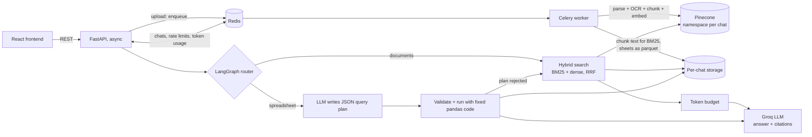

# RAG Document Assistant

Multi-tenant RAG over PDF, Word and Excel, with OCR for scanned pages, hybrid (BM25 + dense) search, and a LangGraph router that answers spreadsheet questions with pandas instead of vector search.


## Results

Measured on a 50-question eval set over 4 test documents, comparing the first version (baseline) with the current one (final). Source: [`eval/results/baseline.jsonl`](eval/results/baseline.jsonl) and [`eval/results/final.jsonl`](eval/results/final.jsonl).

| Question type | n | Retrieval hit rate | Answer accuracy |
|---|---|---|---|
| Factual | 18 | 33% → 83% | 33% → 83% |
| Table | 3 | 0% → 100% | 0% → 100% |
| Paraphrased | 9 | 33% → 78% | 44% → 89% |
| Aggregation (spreadsheet) | 10 | n/a | 0% → 100% |
| Unanswerable | 10 | n/a | 90% → 100% |
| **Overall** | **50** | **30% → 83%** (9/30 → 25/30) | **38% → 92%** (19/50 → 46/50) |

**Retrieval latency, p50:** 550 ms → **314 ms** for retrieval only (search plus token budget, no LLM), over 30 questions. The 550 ms figure is the dense-only timing recorded in commit `87b0722`; 314 ms is in [`retrieval_default.json`](eval/results/retrieval_default.json).

**How the eval works:** [`eval/run_eval.py`](eval/run_eval.py) runs each question through the real pipeline (router, then retrieval, token budget, LLM and citations). A question is a retrieval hit when its evidence sentence is in the chunks sent to the LLM. A separate LLM judge (`gpt-oss-20b`) grades each answer against the expected one. An unanswerable question counts as correct only when the system says it doesn't know.

## Architecture



## Key engineering decisions

- **OCR fallback.** A PDF page with fewer than 200 extractable characters is rendered at 300 DPI and read with Tesseract. One test PDF went from 1 nearly empty chunk to 36 chunks, and its 19 questions went from 0 to 16 answered correctly.
- **Token budget.** Retrieved chunks are added in rank order until about 3,000 tokens (`MAX_CONTEXT_TOKENS`), so every request stays under the Groq free tier's 8,000 tokens per minute.
- **Hybrid search with Reciprocal Rank Fusion.** BM25 and dense search return 20 results each, merged with RRF (k=60). Exact matches on long ID numbers stay on top. Retrieval p50 dropped from 550 ms to about 300 ms.
- **JSON query plans, never generated code.** For spreadsheet questions the LLM returns a plan (sheet, filters, group-by, aggregate). The plan is validated against the real columns and a fixed set of operations, then run with fixed pandas code. LLM output is never executed.
- **Fallback edge.** If a spreadsheet plan is rejected, the LangGraph router sends the question to the documents path instead of answering "I don't know".
- **Per-chat isolation.** Each chat has its own Pinecone namespace and storage folder, every query is also filtered on `chat_id`, and chats belong to a browser session.
- **Reranker measured, then switched off.** A cross-encoder over the top 40 results fixed 1 more question (28/30 hits) but took p50 retrieval to 2,510 ms on CPU, so it ships disabled (`RERANK_TOP_K=0`). Results: [`retrieval_rerank.json`](eval/results/retrieval_rerank.json).
- **Numbered citations.** The LLM cites passages as `[n]`; only the cited chunks are returned, renumbered to match the answer.

## Known limitations

- **q019 ("who signed the notification?") is a retrieval miss.** The signature block sits in a chunk that shares no words with the question, so neither BM25 nor dense search finds it.
- **Follow-up questions aren't rewritten.** Retrieval adds the previous user message to the search query, but nothing turns "and to Lahore?" into a complete question, and the router sees only the current question.
- **The reranker is too slow on CPU** (p50 2.5 s), so it's off. Turn it on with `RERANK_TOP_K=40` on faster hardware.
- **No user accounts.** Isolation is per browser session, not per logged-in user.

## Quick start

Requirements: Docker, Node.js 18+, a Groq API key and a Pinecone API key.

```bash
cp backend/.env.example backend/.env                 # add GROQ_API_KEY and PINECONE_API_KEY
docker compose run --rm worker python -m src.vectorstore   # create the Pinecone index (once)
docker compose up --build                            # Redis + API (:8000) + Celery worker

cd frontend && npm install && npm start              # UI on http://localhost:3000
```

## Running the evals

Run the evals from the repo root, inside the worker image so the OCR setup matches production. In Git Bash on Windows, prefix each command with `MSYS_NO_PATHCONV=1`.

```bash
# Full eval: ingest the test documents, ask all 50 questions, compare with the baseline
docker compose run --rm -v "./eval:/app/eval" -v "./Test documents:/app/Test documents" \
  worker python eval/run_eval.py --out my_run --compare baseline

# Retrieval only (hit rate + latency, no LLM calls, no Groq tokens)
docker compose run --rm -v "./eval:/app/eval" \
  worker python eval/time_retrieval.py --label my_change --compare default
```

Useful `run_eval.py` flags:
- `--types factual,table`: run only these question types.
- `--reuse`: skip ingestion.
- `--reingest FILE ...`: re-ingest only these documents.
- `--retry-errors`: resume after Groq's daily token limit.
- `--limit N`: run only the first N questions.

## Tech stack

| Layer | Choice |
|---|---|
| Frontend | React |
| API | FastAPI (async), Uvicorn |
| Background jobs | Celery + Redis |
| Chats, rate limits | Redis |
| Vector store | Pinecone (serverless), one namespace per chat |
| Keyword search | rank_bm25, merged with Reciprocal Rank Fusion |
| Embeddings | all-MiniLM-L6-v2 (local) |
| LLM | Groq `openai/gpt-oss-120b` (answers, web search); `gpt-oss-20b` as eval judge |
| Spreadsheet router | LangGraph, pandas, parquet |
| OCR | Tesseract, pypdfium2 |
| Eval | Custom harness: retrieval hit rate, LLM-judged accuracy, latency |

## Project structure

```
backend/
  main.py              FastAPI routes: chat, upload, status
  src/
    router.py          LangGraph router: classify -> plan -> execute -> answer | fallback
    sheets.py          Parquet storage, query-plan validation, fixed pandas execution
    vectorstore.py     Pinecone, hybrid search, RRF, exact-ID matching, optional rerank
    lexical.py         BM25 index over each chat's chunks
    reranker.py        Cross-encoder reranker (off by default)
    loaders.py         PDF (with OCR fallback), Word, Excel/CSV -> chunks
    llm.py             Groq calls, prompts, citations, token logging
    worker.py          Celery ingestion task
    chat_store.py, rate_limit.py, redis_client.py, embeddings.py, chunking.py
frontend/src/          React chat UI
eval/
  dataset.jsonl        50 questions with expected answers and evidence
  run_eval.py          End-to-end eval
  time_retrieval.py    Retrieval-only eval (hit rate, latency)
  results/             All runs: baseline, after_ocr, after_router, final, ...
Test documents/        The 4 documents the eval uses
docker-compose.yml     Redis, API, worker
```
