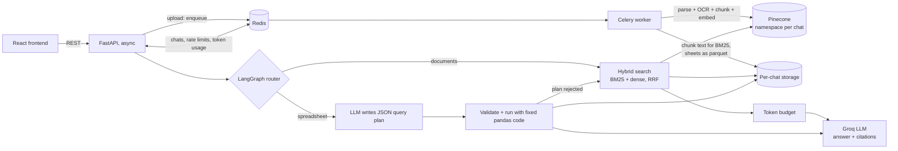

# RAG Document Assistant

**Live demo:** _coming soon_ (placeholder until it's deployed)

RAG over PDF, Word and Excel with per-chat isolation (no user accounts yet). It uses OCR for scanned pages, hybrid (BM25 + dense) search, and a LangGraph router that answers spreadsheet questions with pandas instead of vector search.


## Results

Eval of 50 questions over 4 documents, **measured at commit `a39e6fe`**, comparing the first version (baseline) with that version (final). Sources: [`baseline.jsonl`](eval/results/baseline.jsonl) and [`final.jsonl`](eval/results/final.jsonl).

| Question type | n | Retrieval hit rate | Answer accuracy |
|---|---|---|---|
| Factual | 18 | 33% (6/18) → 83% (15/18) | 33% (6/18) → 83% (15/18) |
| Table | 3 | 0% (0/3) → 100% (3/3) | 0% (0/3) → 100% (3/3) |
| Paraphrased | 9 | 33% (3/9) → 78% (7/9) | 44% (4/9) → 89% (8/9) |
| Aggregation (spreadsheet) | 10 | n/a | 0% (0/10) → 100% (10/10) |
| Unanswerable | 10 | n/a | 90% (9/10) → 100% (10/10) |
| **Overall** | **50** | **30% (9/30) → 83% (25/30)** | **38% (19/50) → 92% (46/50)** |

- **The current version** adds the router fallback and hybrid search, and hasn't had a full 50-question re-run. Its retrieval-only run hits 27/30 ([`retrieval_default.json`](eval/results/retrieval_default.json)).
- **The spreadsheet** behind the aggregation row has since been replaced with a synthetic one. Re-run on the synthetic sheet, aggregation scored 100% (10/10) ([`after_synthetic.jsonl`](eval/results/after_synthetic.jsonl)).

**Retrieval latency, p50 over 30 questions, retrieval only (no LLM):** 550 ms → 314 ms. The drop most likely comes from fetching 20 results from Pinecone instead of 40. BM25 runs locally and adds little time. The two changes weren't measured separately. The 550 ms figure is the pre-hybrid timing recorded in commit `846d573`; 314 ms is in [`retrieval_default.json`](eval/results/retrieval_default.json).

**How the eval works:** [`eval/run_eval.py`](eval/run_eval.py) runs each question through the real pipeline (router, then retrieval, token budget, LLM and citations).
- **Retrieval hit:** the question's evidence sentence is in the chunks sent to the LLM.
- **Accuracy:** a separate LLM judge (`gpt-oss-20b`) grades each answer against the expected answer. An unanswerable question counts as correct only when the system says it doesn't know.

### Eval limitations

- **Small set:** 50 questions over 4 documents, written with LLM help and checked by hand.
- **No held-out test set:** prompts were changed after seeing failures on these same questions, so the scores are optimistic.
- **One run per question:** each question was run once, and answers vary slightly between runs.
- **Strict judge:** an answer with the right figure but missing a second detail the expected answer includes is marked wrong.

## Architecture



## Key engineering decisions

- **OCR fallback.** A PDF page with fewer than 200 extractable characters is rendered at 300 DPI and read with Tesseract. One test PDF went from 1 nearly empty chunk to 36 chunks, and its 19 questions went from 0 to 16 answered correctly.
- **Token budget.** Retrieved chunks are added in rank order until about 3,000 tokens (`MAX_CONTEXT_TOKENS`), so every request stays under the Groq free tier's 8,000 tokens per minute.
- **Hybrid search with Reciprocal Rank Fusion.** BM25 and dense search return 20 results each, merged with RRF (k=60). Exact matches on long ID numbers stay on top. In the retrieval-only eval this changed no hits, but it finds chunks by exact wording that dense search misses.
- **JSON query plans, never generated code.** For spreadsheet questions the LLM returns a plan (sheet, filters, group-by, aggregate). The plan is validated against the real columns and a fixed set of operations, then run with fixed pandas code. LLM output is never executed.
- **Fallback edge.** If a spreadsheet plan is rejected, the LangGraph router sends the question to the documents path instead of answering "I don't know".
- **Per-chat isolation (no user accounts yet).** Each chat has its own Pinecone namespace and storage folder, every query is also filtered on `chat_id`, and chats belong to a browser session.
- **Reranker measured, then switched off.** A cross-encoder over the top 40 results raised retrieval hits from 27/30 to 28/30 but took p50 retrieval to 2,510 ms on CPU, so it ships disabled (`RERANK_TOP_K=0`). Results: [`retrieval_rerank.json`](eval/results/retrieval_rerank.json).
- **Numbered citations.** The LLM cites passages as `[n]`; only the cited chunks are returned, renumbered to match the answer.

## Known limitations

- **Text that shares no words with the question isn't found.** For example, a signature block naming who signed a notice sits in its own chunk, so neither keyword nor semantic search retrieves it.
- **Follow-up questions aren't rewritten.** Retrieval adds the previous user message to the search query, but nothing turns "and to Lahore?" into a complete question, and the router sees only the current question.
- **Spreadsheet answers support only count, sum, mean, max and min**, with filters and grouping. Derived values such as a per-kilogram rate aren't computed.
- **The reranker is too slow on CPU** (p50 2.5 s), so it's off. Turn it on with `RERANK_TOP_K=40` on faster hardware.
- **Web search runs only when a request sets `allow_web_search: true`.** The UI doesn't send it yet, and it isn't covered by the eval.
- **No user accounts:** isolation is per browser session.

## Quick start

Requirements: Docker, Node.js 18+, a Groq API key and a Pinecone API key.

```bash
cp backend/.env.example backend/.env                       # add GROQ_API_KEY and PINECONE_API_KEY
docker compose run --rm worker python -m src.vectorstore   # create the Pinecone index (once)
docker compose up --build                                  # Redis + API (:8000) + Celery worker

cd frontend && npm install && npm start                    # UI on http://localhost:3000
```

## Running the evals

```bash
# End-to-end: all 50 questions, compared with the final results
docker compose run --rm -v "./eval:/app/eval" -v "./Test documents:/app/Test documents" \
  worker python eval/run_eval.py --out my_run --compare final

# Retrieval only: hit rate + latency, no LLM calls
docker compose run --rm -v "./eval:/app/eval" \
  worker python eval/time_retrieval.py --label my_change --compare default
```

All flags, Windows/Git Bash notes and rate-limit handling are in [docs/evals.md](docs/evals.md).

## Tech stack

| Layer | Choice |
|---|---|
| Frontend | React |
| API | FastAPI (async), Uvicorn |
| Background jobs | Celery + Redis |
| Chats, rate limits | Redis |
| Vector store | Pinecone (serverless), one namespace per chat |
| Keyword search | rank_bm25, merged with Reciprocal Rank Fusion |
| Embeddings | all-MiniLM-L6-v2 (local) |
| LLM | Groq `openai/gpt-oss-120b`; `gpt-oss-20b` as the eval judge |
| Spreadsheet router | LangGraph, pandas, parquet |
| OCR | Tesseract, pypdfium2 |

## Project structure

| Path | Contents |
|---|---|
| `backend/` | FastAPI app, Celery worker, router, retrieval, ingestion (`src/`) |
| `frontend/` | React chat UI |
| `eval/` | Eval dataset, eval scripts, synthetic-sheet generator, results of every run |
| `Test documents/` | The 4 documents the eval uses (the spreadsheet is synthetic) |
| `docs/` | Eval guide (`evals.md`) and the demo screenshot |
| `docker-compose.yml` | Redis, API and worker services |
